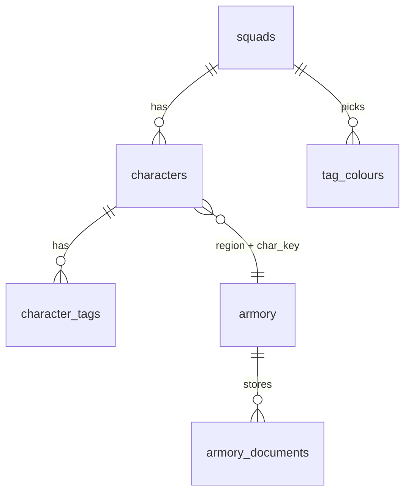

# Design

## Crates

- `zesquad-core`: no I/O. Character names (`Name-Surname`, normalised; the lower-case key is
  what the database and the API use), tags (case-insensitive, first spelling kept), squad
  names, regions, when a character is due for a refresh, reading Battle.net JSON into a `Profile`, and
  the tags and tag colours that come from it; the auction houses followed and turning their
  dumps into prices per item and per day.
  Parsing is lenient because Forever's responses are undocumented.
- `zesquad`: the binary. `cli` (clap, every option also an env var), `db` (sqlx + SQLite, all
  queries), `armory` (Battle.net client), `sync` (background refresh), `auctions` (background
  auction prices), `web` (axum handlers,
  askama templates), `assets` (CSS and htmx embedded with rust-embed).

## Data

- A squad has a region (`eu`, `us`, `tw`), picked when it's made and fixed after; its characters
  are looked up there, with that region's host, namespace and locale. Squads from before
  regions took their characters' region, or `ZESQUAD_BNET_REGION` when empty.
- A character belongs to one squad; the same character in two squads is two rows.
- `armory` holds one row per `(region, char_key)`, shared by every squad with that character, so
  each character is fetched once. Rows for characters no squad has any more are kept but not
  refreshed.
- `tag_colours` holds the colours picked for a squad's tags, by tag key, separate from the
  tags themselves: a colour stays when a tag goes away and comes back.
- `auction_houses`, `auction_snapshots`, `auction_snapshot_times` and `auction_daily` hold
  auction prices by region and house, apart from squads (see Auction prices).
- `armory_documents` keeps each endpoint's raw JSON from the last good fetch; the pages parse it
  the first time a character is shown after a fetch and keep the result in memory. Showing a new
  field needs no refetch, and a failed fetch keeps the old data.

## Armory sync

One task loops: fetch every due character, then sleep until woken (a character added or a
refresh asked for) or a minute passes. Due means never fetched or asked for (`pending`),
or older than the interval (found / not found), or a tenth of it after a failure.

Per character it fetches the summary first; a 404 there marks the character not found. Then
media, equipment, specializations, professions and, for hunters, hunter pets. A 404 on one of
those is skipped; any other error marks the whole fetch failed. The app token is cached until
five minutes before it expires (halfway, for one that lives shorter), and a 401 gets one retry
with a new token; a second 401 fails the fetch.

## Auction prices

With `ZESQUAD_AUCTIONS` (and credentials), a second task follows the big PvP and PvE houses of
both factions in EU and US (`zesquad_core::auctions::HOUSES`; the rest is a TODO there). It runs
apart from the Armory sync so a 50 MB dump never delays a character. Every minute it goes
through the houses:

- A house not asked for in 15 minutes is fetched: its item and commodity dumps (gzipped), read
  into one snapshot off the async threads. Per item: lowest unit price, median by units (so one
  cheap stack of 20 outweighs one dear single), units on sale, and auctions. Bid-only auctions
  are left out; item variants count as the plain item.
- Battle.net updates the dumps about hourly, so most checks find the same auctions: a snapshot
  whose fingerprint (from the auction ids) matches the last one isn't stored again.
- Finished UTC days are condensed into `auction_daily`: lowest price, median and highest of the
  snapshots' medians, average units, number of snapshots. `condensed_through` remembers how far.
- Snapshots older than seven whole days are deleted, but never before their day is condensed.

Sizes, measured on 2026-11-20: a big house has about 6,600-7,000 different items, so a round of
snapshots is about 54,000 rows, 2.2 MB in SQLite. Hourly for a week that's about 9 million
rows, under 400 MB. `auction_daily` grows by the same 2.2 MB a day, about 800 MB a year.
Fetching and reading a house's two dumps takes about a second.

`auction_snapshot_times` has a row per stored snapshot. Pages count snapshots there, and find a
few items' prices by looking each one up in each snapshot by key (about 170 snapshots a week),
instead of scanning the week's millions of rows.

`/auctions`, linked in the header, shows, as a first use of the data, five leathers' median
price in each house now, a line of it over the last seven days (an SVG path drawn on the
server, `zesquad_core::sparkline`, so no script), its lowest and highest, and the average on
hover; then how collecting is going for each house. Money is shown with coins like the game.
Item names aren't fetched yet, so the leathers are named in `zesquad_core::auctions::LEATHER`.

A failed fetch is logged and stored in `auction_houses.error`, and tried again on the next
check; the house's snapshots stay.

## Tags

A character's tags are the ones people typed (`character_tags`) plus automatic ones from its
Armory data: class, main spec, race, faction and every profession (`zesquad_core::tags`). The
automatic ones are worked out when the page renders, never stored, so they follow the character
and can't be removed; a character the Armory hasn't answered for has none. The main spec is the
talent tree with the most points in the active group, if no other tree ties it. A typed tag
the Armory also gives is shown once, as automatic, and comes back as a typed one if the
character loses the automatic tag. Since tags aren't all in the database, the roster filters
by tag after loading the squad.

A tag's colour is the one picked for it in the squad, else its default: class tags default to
the classic client's class colours (`RAID_CLASS_COLORS`), others to none. Chip text is black or
white, whichever contrasts more with the colour (WCAG relative luminance).

## Web

Every action is a plain HTML form POST that redirects back (so it works without JavaScript).
With htmx, the same forms post with `HX-Request` and get the re-rendered roster section back,
which replaces the old one; validation errors come back the same way, with what was typed kept.
While any character is still pending, the roster polls itself every 3 seconds.

Static files are served under `/static/<version>/` with a one-year cache in release builds, so a
new version is never stuck behind old CSS.

A squad's id, a random UUID v4 written in Crockford base32 (`squad_id.rs` in core), is its
secret; squads made before that have the dashed UUID form, which still works. Anything that
changes a squad checks the character belongs to that squad. Optionally, `ZESQUAD_PASSWORD`
puts one shared password in front of everything (`auth.rs`, an axum middleware). Logging in sets an HttpOnly, `SameSite=Lax` cookie holding
`sha256(key, 0, password)`, where the key is random and kept in the `settings` table: sessions
survive restarts, the cookie isn't the password, and changing the password logs everyone out.
`/login`, `/logout`, `/healthz`, `/version` and static files stay open. htmx requests without a
session get `HX-Redirect` to the login page. A wrong password costs 750 ms, to slow guessing; put
a reverse proxy with rate limiting in front for more. The cookie is `Secure` when the proxy says
the request came over HTTPS (`X-Forwarded-Proto`).
