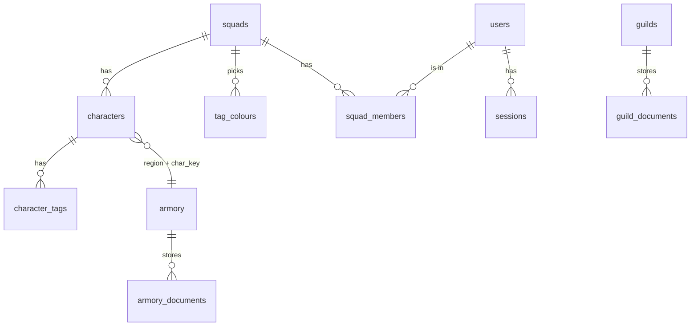

# Design

## Crates

- `zesquad-core`: no I/O. Character names (`Name-Surname`, normalised; the lower-case key is
  what the database and the API use), tags (case-insensitive, first spelling kept), squad
  names, regions, when a character is due for a refresh, reading Battle.net JSON into a `Profile`, and
  the tags and tag colours that come from it; the auction houses followed and turning their
  dumps into prices per item and per day.
  Parsing is lenient because Forever's responses are undocumented.
- `zesquad`: the binary. `cli` (clap, every option also an env var), `db` (sqlx + SQLite, all
  queries), `armory` (Battle.net client), `sync` (background refresh), `auctions` (background
  auction prices), `web` (axum handlers,
  askama templates), `assets` (CSS and htmx embedded with rust-embed).

## Data

- A squad has a region (`eu`, `us`, `tw`), picked when it's made and fixed after; its characters
  are looked up there, with that region's host, namespace and locale. Squads from before
  regions took their characters' region, or `ZESQUAD_BNET_REGION` when empty.
- A character belongs to one squad; the same character in two squads is two rows.
- `armory` holds one row per `(region, char_key)`, shared by every squad with that character, so
  each character is fetched once. Rows for characters no squad has any more are kept but not
  refreshed.
- `tag_colours` holds the colours picked for a squad's tags, by tag key, separate from the
  tags themselves: a colour stays when a tag goes away and comes back.
- `guilds` holds one row per `(region, slug)` someone opened a page for, apart from squads, and
  `guild_documents` its guild and roster JSON, like `armory` and `armory_documents` (see Guilds).
- `auction_houses`, `auction_snapshots`, `auction_snapshot_times` and `auction_daily` hold
  auction prices by region and house, apart from squads (see Auction prices).
- `armory_documents` keeps each endpoint's raw JSON from the last good fetch; the pages parse it
  the first time a character is shown after a fetch and keep the result in memory. Showing a new
  field needs no refetch, and a failed fetch keeps the old data.

## Armory sync

One task loops: fetch every due character, then sleep until woken (a character added or a
refresh asked for) or a minute passes. Due means never fetched or asked for (`pending`),
or older than the interval (found / not found), or a tenth of it after a failure.

Per character it fetches the summary first; a 404 there marks the character not found. Then
media, equipment, specializations, professions and, for hunters, hunter pets. A 404 on one of
those is skipped; any other error marks the whole fetch failed. The app token is cached until
five minutes before it expires (halfway, for one that lives shorter), and a 401 gets one retry
with a new token; a second 401 fails the fetch.

## Guilds

`/g/<region>/<slug>` shows a guild: its name, member count, faction and age, then its roster
as a table (name, level, class, race, rank), 50 members a page. Character cards link their
guild there (`guild.slug` in the summary), when Armory lookups are on.

A guild costs two requests, the guild and its roster, which already has every member's name,
level, class and race (as ids, named in `zesquad_core::guild`). Members aren't looked up one by
one: that would be 5-6 requests each, 4,000 or more for a big guild. Battle.net sends the
whole roster at once, even 800 members (about 650 KB).

The first time anyone opens a guild it's added to `guilds` as pending and the Armory sync is
woken; the page polls itself (htmx, `hx-select`) until it's there. Opening guilds nobody opened
before counts towards a limit of its own (10 an hour per client), so links can't make the
server fetch any number of guilds. After that the sync refreshes a guild like a character
(same interval and `refresh::is_due`), but only while someone opened its page in the last 7
days (`viewed_at`, written at most hourly). A 404 on the guild shows "not on the Armory" with a
404 status.

The roster is parsed once per fetch, off the async threads, and kept in memory
(`db::GuildCache`, the same kind of cache as the characters'). Searching, the class filter, sorting
(rank, name, level) and paging are `zesquad_core::guild::page`, done per request on the parsed
roster: every word typed has to appear in `name surname`. They're plain links and a GET form,
so they work without script; with htmx the search updates the table as you type and puts the
search in the address bar.

## Auction prices

With `ZESQUAD_AUCTIONS` (and credentials), a second task follows the big PvP and PvE houses of
both factions in EU and US (`zesquad_core::auctions::HOUSES`; the rest is a TODO there). It runs
apart from the Armory sync so a 50 MB dump never delays a character. Every minute it goes
through the houses:

- A house not asked for in 15 minutes is fetched: its item and commodity dumps (gzipped), read
  into one snapshot off the async threads. Per item: lowest unit price, median by units (so one
  cheap stack of 20 outweighs one dear single), units on sale, and auctions. Bid-only auctions
  are left out; item variants count as the plain item.
- Battle.net updates the dumps about hourly, so most checks find the same auctions. Each dump
  is asked for with `If-Modified-Since` set to the `Last-Modified` of the one stored last
  (`auction_houses.items_modified` / `commodities_modified`); when both answer 304 nothing is
  downloaded or stored. When only one changed, the other is fetched again to make a whole
  snapshot. As a backstop, a snapshot whose fingerprint (from the auction ids) matches the last
  one isn't stored again.
- Finished UTC days are condensed into `auction_daily`: lowest price, median and highest of the
  snapshots' medians, average units, number of snapshots. `condensed_through` remembers how far.
- Snapshots older than seven whole days are deleted, but never before their day is condensed.

Sizes, measured on 2026-11-20: a big house has about 6,600-7,000 different items, so a round of
snapshots is about 54,000 rows, 2.2 MB in SQLite. Hourly for a week that's about 9 million
rows, under 400 MB. `auction_daily` grows by the same 2.2 MB a day, about 800 MB a year.
Fetching and reading a house's two dumps takes about a second.

`auction_snapshot_times` has a row per stored snapshot. Pages count snapshots there, and find a
few items' prices by looking each one up in each snapshot by key (about 170 snapshots a week),
instead of scanning the week's millions of rows.

`/auctions`, linked in the header, shows, as a first use of the data, five leathers' median
price in each house now, a line of it over the last seven days (an SVG path drawn on the
server, `zesquad_core::sparkline`, so no script), its lowest and highest, and the average on
hover; then how collecting is going for each house. Money is shown with coins like the game.
The leathers are still named in `zesquad_core::auctions::LEATHER`. A search box above them (a plain GET form,
`?q=`, that htmx swaps in as you type, like the guild roster's) shows the same for up to 20 items
whose name contains what was typed, from `items`: names starting with it first, then shorter
ones. Under each name is what a vendor pays, read from the item's stored document
when the page is shown (the tooltip's price; see Items in `docs/battlenet-api.md`).

The same task fills in `items`, the details of every item seen (a row is added for each new item
when a snapshot is stored). Each round it asks Battle.net about 120 of them, Forever's item data
first and Classic Era's when Forever's doesn't have it (see Items in `docs/battlenet-api.md`), and
keeps the name, quality and class for searching beside the whole document. An item neither has is
asked about again after a week, a failed ask after an hour; a round stops at its first failure.
Icons are looked up apart from the details, also 120 a round, from Forever's item media only
(it has icons for items Forever's item data lacks); only the icon's file id is kept. Pages link
Blizzard's render host for the image, at 36 pixels shown at 18, and the game's question mark for
items without one. The roughly 7,600 items seen take about an hour. `/auctions` says how far it has got.

When Battle.net answers 429, the client sends nothing more, for any page or task, until the
`Retry-After` has passed (10 seconds when it doesn't say, at most an hour; `zesquad_core::retry`):
the quota is per client. A round of item lookups that hits it just stops, without marking the item
as failed.

A failed fetch is logged and stored in `auction_houses.error`, and tried again on the next
check; the house's snapshots stay.

### Raw dumps

With `ZESQUAD_ARCHIVE_DIR`, every dump Battle.net says is new is also kept as it was sent, for
uses nobody has thought of yet (the snapshots drop single auctions, bids and item variants). A
dump only fetched again to complete a snapshot isn't kept twice. Each is written, before it's
read (so a dump we can't read is kept too), as zstd-compressed JSON at
`{region}/{house}/{YYYY-MM-DD}/{Last-Modified as 20261120T202348Z}-{items|commodities}.json.zst`
(`zesquad_core::archive`); the fetch time stands in when Battle.net sends no `Last-Modified`.

With a bucket (`ZESQUAD_ARCHIVE_S3_*`: R2, Hetzner or anything else S3-compatible), the folder
is only a queue: after each round of houses the files there are uploaded, oldest first, and
removed. A failed upload stops the round and the rest wait for the next one, so an outage
loses nothing. `s3.rs` presigns each PUT with rusty-s3 (Signature Version 4, sans-IO) and
sends it with reqwest, rather than pulling in an SDK; the signed URLs live five minutes and are
kept out of errors, since each is a credential for its upload. Without a bucket, the folder is
the archive.

Sizes: a house's two dumps are about 2.6 MB gzipped (see `docs/battlenet-api.md`); level 9 zstd
is about 13% smaller than gzip. With eight houses changing hourly that's roughly 400 MB a day,
12 GB a month. Kept for good for now; to be looked at again in December 2026.

## Tags

A character's tags are the ones people typed (`character_tags`) plus automatic ones from its
Armory data: class, main spec, race, faction and every profession (`zesquad_core::tags`). The
automatic ones are worked out when the page renders, never stored, so they follow the character
and can't be removed; a character the Armory hasn't answered for has none. The main spec is the
talent tree with the most points in the active group, if no other tree ties it. A typed tag
the Armory also gives is shown once, as automatic, and comes back as a typed one if the
character loses the automatic tag. Since tags aren't all in the database, the roster filters
by tag after loading the squad.

The roster can be sorted (`?sort=` name, level, item level or last played; `zesquad_core::roster`)
after filtering: numbers highest first, characters without one last, ties by name. Without a
sort it's the order characters were added. A line above it counts the members shown, how many
share the highest level, and the factions. Every roster form posts the filter and sort it came
from, so the page comes back the same.

A tag's colour is the one picked for it in the squad, else its default: class tags default to
the classic client's class colours (`RAID_CLASS_COLORS`), others to none. Chip text is black or
white, whichever contrasts more with the colour (WCAG relative luminance).

## Web

Every action is a plain HTML form POST that redirects back (so it works without JavaScript).
With htmx, the same forms post with `HX-Request` and get the re-rendered roster section back,
which replaces the old one; validation errors come back the same way, with what was typed kept.
While any character is still pending, the roster polls itself every 3 seconds.

Static files are served under `/static/<version>/` with a one-year cache in release builds, so a
new version is never stuck behind old CSS.

A squad page shows its full link in a field with a **Copy link** button (`static/share.js`; the
button stays hidden without script). The link is built from the request's `X-Forwarded-Host`
or `Host` and `X-Forwarded-Proto`, only if the host looks like one (`link.rs` in core); else
it's just the path.

Pages carry a favicon, `theme-color` and Open Graph tags, so a squad link pasted into a chat
previews as the squad's name and character count. The preview shows nothing the page doesn't.
With `ZESQUAD_PASSWORD` set, previews get the login page instead.

Someone without squads yet gets, on the front page, "how it works" in three steps and an
example squad of made-up characters, rendered with the same card (`member.html`) as a real
roster in its read-only form: no forms, no links.

Logged in, the front page lists the squads you're in first, then the others this browser
opened. Either way, squads you can't see (private ones you're not in) are left out.

The front page lists the squads this browser opened lately, from a cookie (`zesquad_recent`,
HttpOnly, `SameSite=Lax`) holding up to ten squad ids, newest first (`recent.rs` in core). A
squad page puts its id first; **Forget** takes one off. Ids of squads that are gone are dropped
and the cookie written back. The cookie only holds ids the browser already had, so it reveals
nothing new.

A squad can post its news to a Discord channel through a webhook (`discord.rs`, and
`zesquad_core::discord`): a character added, and a character going up a level, which the
Armory sync spots by comparing the stored summary's level with the new one. Only Discord's own
webhook URLs are taken, so a squad can't make the server send requests elsewhere; the
webhook's path is kept in `squads.discord_webhook`, and pages only ever show the end of its id,
since the token is a secret. Setting one up posts a hello and waits for it, so a wrong or
deleted webhook is refused on the spot; later posts go in the background and a failure is only
logged. Messages turn mentions off (`allowed_mentions`) and escape Markdown, so names can't
ping anyone or add links, and they link the squad when `ZESQUAD_PUBLIC_URL` is set. Group DMs
can't have webhooks, so it's a server channel or one of its threads (`?thread_id=`).
Each news message ends with a line of flavour in Discord's small print (`-# `): a welcome for
a join, and for a level-up a line for the milestone (10, 20, … 60, some per class, like a
hunter's pet at 10) or else one for the character's class or anyone. The line is picked by
hashing the name and level rather than at random, so the same event always reads the same.

With `ZESQUAD_PUBLIC_URL` and Battle.net credentials, people can log in with Battle.net
(`login.rs`, authorization code flow, `scope=openid`): zesquad keeps the account id and
BattleTag in `users`, and nothing else. `/auth/login` puts a random `state` and the page to
return to in a short-lived cookie (`zesquad_login`, path `/auth`) and redirects to Battle.net;
`/auth/callback` checks the state, swaps the code for a player token, asks `/userinfo`, and
throws the token away. A session is a random token in `zesquad_user` (HttpOnly,
`SameSite=Lax`, `Secure` when the public URL is HTTPS); `sessions` keeps its SHA-256, so the
database alone can't log anyone in. Sessions last 30 days and are extended when used in their
second half (`login::load`, a middleware that also puts the user in the request). **Log out**
ends both this session and the shared-password one. `/account` shows your BattleTag and lets you log out
everywhere (every session of yours deleted) or delete your account (the `users` row, and
through foreign keys everything hanging off it; squads you own are handed on, see below). `/privacy`, linked from every page, lists
everything zesquad keeps.

With accounts on, a squad has members (`squad_members`): one `owner`, who started it, and
`member`s. A squad's `visibility` says who else sees it: `private` (only members), `unlisted`
(anyone with the link can look) or `public` (also listed). Squads from before accounts are
`open`: anyone with the link sees and edits them, and nobody owns them, until someone logged
in opens one: they become its owner, and it turns `unlisted` with an invite token
(`db::claim`, guarded so only the first gets it). What a role may do
with a squad of a given visibility is one function, `access::allows` in core. Starting a squad
takes a login; it starts `unlisted`, with a random invite token (`squads.invite_token`). With
accounts off, squads are made `open` and stay that way. Nobody has a role then, so squads made
while accounts were on keep their visibility but can't be changed until accounts are back: a
private one stays a 404, an unlisted one read-only. Turning logins off never exposes a squad.

Every squad route takes one of the extractors in `web.rs` (`CanView`, `CanEdit`,
`CanConfigure`, …), which loads the squad and your role and applies the rule; `db::Squad` itself
isn't an extractor, so a new route can't skip the check. A squad you can't see is a 404, the
same as one that doesn't exist. One you can see but not change is a 403; for htmx it's a 200
with `HX-Refresh` instead, since htmx doesn't swap a 403, and the reload shows the page as you
may see it. Members change the roster; renaming and the Discord channel are the owner's. Anyone
else gets the roster read-only (`editable: false`), polling included.

The squad page itself is the name, the view link and the roster. Everything else lives on
`/s/<id>/settings`, linked from the squad's heading for whoever has something there (members,
and anyone with an open squad): the name, the invite link, who can see it, the members, Discord
and deleting it, each shown only to whoever may use it. Anyone else gets a 403 there. Changes
made on it come back to it.

Members see the squad's invite link, `/join/<invite token>`, on its settings page, and can pass
it on; the squad page keeps only the view link (left out for a private squad, where it would be
a 404 to anyone else). Opening it logged
out sends you to log in and back; logged in, it asks "Join *squad*?" with one button. Only the
POST joins, so a chat app previewing the link can't join anyone. The owner can **Reset** the
token; the old link stops working, and members who joined with it stay.

The owner picks who can see the squad on its settings page: **Only members** (`private`), **Anyone
with the link** (`unlisted`) or **Everyone** (`public`); `open` isn't offered. A private squad's
page never puts its name in the title or Open Graph tags, so even a preview made with a
member's cookies says only "zesquad"; without them it's a 404 anyway.

Members see a **Members** list: BattleTags, roles, when each joined; nobody else sees
BattleTags. The owner can remove members (which also resets the invite link, since they saw
it as members) and **Delete squad** (its characters, tags, colours
and members go through the foreign keys); a member can **Leave**; the owner can't leave, only
delete. Deleting your account hands each squad you own to the member who's been in it
longest, and deletes squads with nobody else in them (`db::delete_user`, one transaction);
`/account` lists which before you confirm.

`/squads` (**Squads** in the header, with accounts on) lists the public squads by name, with
their character count and region.

Each client may start 10 logins a minute (Battle.net or the shared password), 10 squads an hour
and 60 other changes (any other form post) a minute; pages, polling and logging out aren't
limited (`limits.rs`, counting in `zesquad_core::limit`). Over a limit is a 429 with
`Retry-After` and a page saying how long to wait; htmx doesn't swap that, so `slow-down.js`
says so in an alert. A client is an IPv4 address or an IPv6 /64. Behind a reverse proxy every
request comes from the proxy, so `ZESQUAD_TRUST_PROXY` names where the proxy puts the client's
address: `cloudflare` reads `CF-Connecting-IP`, which only Cloudflare sets; `forwarded-for`
reads the last `X-Forwarded-For` entry across all its header lines, the one the proxy added
(HAProxy adds a line of its own rather than appending). Trusting a header no proxy sets would
let clients pick their address, so it's off by default; with it off, the first request that
carries proxy headers logs a warning, since then everyone shares the proxy's limits. The counts
live in memory and a restart forgets them; finished windows are dropped once 10,000 clients are
counted, at most once a second.

A squad's id, a random UUID v4 written in Crockford base32 (`squad_id.rs` in core), is the
secret of an `open` squad, and the view link of the others; squads made before that have the dashed UUID form, which still works. Anything that
changes a squad checks the character belongs to that squad. Optionally, `ZESQUAD_PASSWORD`
puts one shared password in front of everything (`auth.rs`, an axum middleware). Logging in sets an HttpOnly, `SameSite=Lax` cookie holding
`sha256(key, 0, password)`, where the key is random and kept in the `settings` table: sessions
survive restarts, the cookie isn't the password, and changing the password logs everyone out.
`/login`, `/logout`, `/healthz`, `/version` and static files stay open. htmx requests without a
session get `HX-Redirect` to the login page. A wrong password costs 750 ms, to slow guessing. The cookie is `Secure` when the proxy says
the request came over HTTPS (`X-Forwarded-Proto`).
