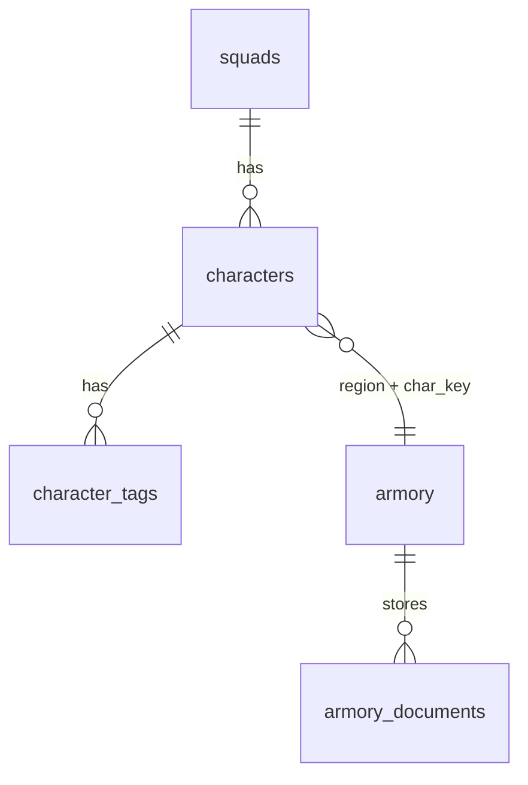

# Design

## Crates

- `squadron-core`: no I/O. Character names (`Name-Surname`, normalised; the lower-case key is
  what the database and the API use), tags (case-insensitive, first spelling kept), squad
  names, when a character is due for a refresh, and reading Battle.net JSON into a `Profile`.
  Parsing is lenient because Forever's responses are undocumented.
- `squadron`: the binary. `cli` (clap, every option also an env var), `db` (sqlx + SQLite, all
  queries), `armory` (Battle.net client), `sync` (background refresh), `web` (axum handlers,
  askama templates), `assets` (CSS and htmx embedded with rust-embed).

## Data

- A character belongs to one squad; the same character in two squads is two rows.
- `armory` holds one row per `(region, char_key)`, shared by every squad with that character, so
  each character is fetched once. Rows for characters no squad has any more are kept but not
  refreshed.
- `armory_documents` keeps each endpoint's raw JSON from the last good fetch; the pages parse it
  on render. Showing a new field needs no refetch, and a failed fetch keeps the old data.

## Armory sync

One task loops: fetch every due character, then sleep until woken (a character added or a
refresh asked for) or a minute passes. Due means never fetched or asked for (`pending`),
or older than the interval (found / not found), or a tenth of it after a failure.

Per character it fetches the summary first; a 404 there marks the character not found. Then
media, equipment, specializations, professions and, for hunters, hunter pets. A 404 on one of
those is skipped; any other error marks the whole fetch failed. The app token is cached until
five minutes before it expires, and a 401 gets one retry with a new token.

## Web

Every action is a plain HTML form POST that redirects back (so it works without JavaScript).
With htmx, the same forms post with `HX-Request` and get the re-rendered roster section back,
which replaces the old one; validation errors come back the same way, with what was typed kept.
While any character is still pending, the roster polls itself every 3 seconds.

Static files are served under `/static/<version>/` with a one-year cache in release builds, so a
new version is never stuck behind old CSS.

There's no login: a squad's UUID v4 is its secret. Anything that changes a squad checks the
character belongs to that squad.
